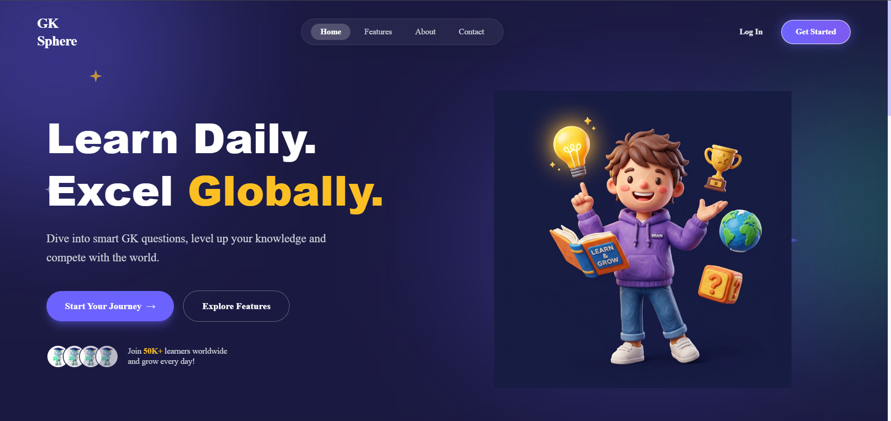
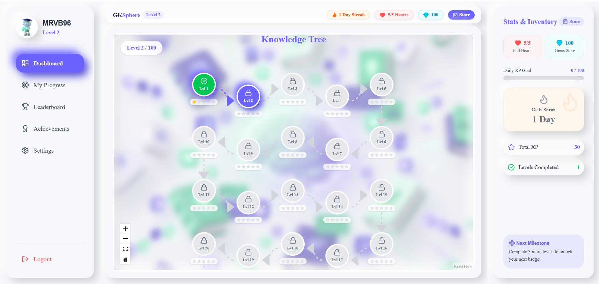
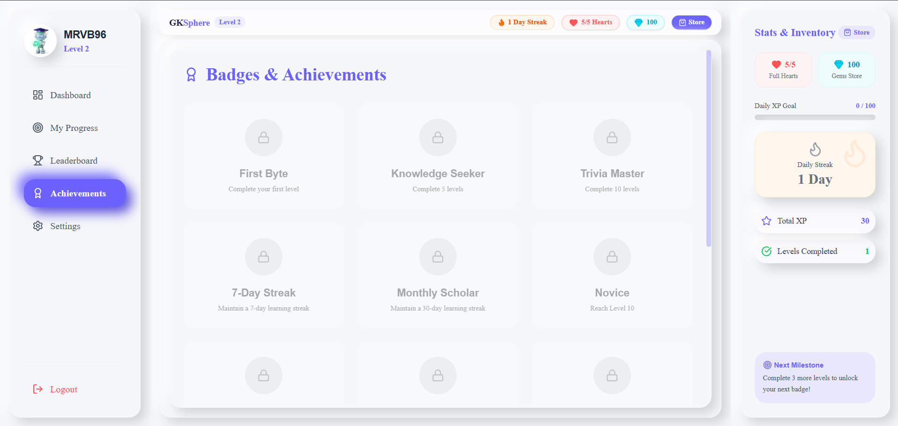
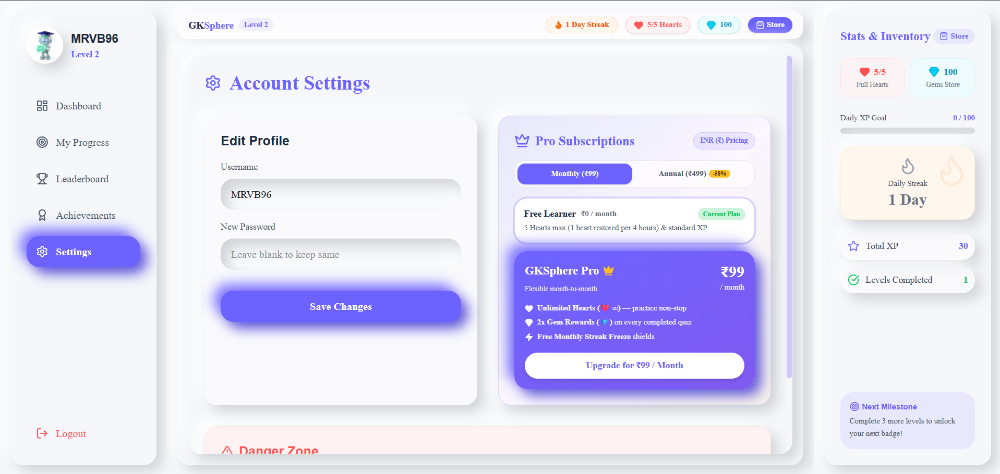

# 🌐 GKSphere — Gamified Knowledge Learning Platform

<div align="center">

[](https://opensource.org/licenses/MIT)
[](https://nodejs.org/)
[](https://react.dev/)
[](https://tailwindcss.com/)
[](https://www.mongodb.com/)
[](https://vitejs.dev/)

**Learn Daily. Excel Globally.**  
An interactive, Duolingo-style gamified General Knowledge web application built with modern web technologies, an interactive skill-tree progression model, lives/hearts economy, and global leaderboards.

[Live Demo](http://localhost:5173) • [Features](#-features) • [Screenshots](#-screenshots--showcase) • [Tech Stack](#-tech-stack) • [Quick Start](#-running-locally) • [Monetization](#-monetization-model)

</div>

---

## 📸 Screenshots & Showcase

### 🚀 Landing Page
> Clean 3D claymorphism aesthetic, interactive statistics banner, and responsive hero design.



---

### 🗺️ Interactive Knowledge Tree & Real-Time Economy
> Visual level progression tree powered by `@xyflow/react` with touch pan & zoom, real-time lives/hearts (`❤️ 5/5`), gems balance (`💎`), and streak tracking.



---

### 🏆 Badges & Achievements
> Level milestones and habit streaks from *First Byte* to *GK God* with visual unlock states.



---

### 🇮🇳 Affordable INR Subscription Plans & Account Settings
> Consumer-friendly Indian Rupee pricing (Monthly ₹99 / Annual ₹499) for GKSphere Pro with Unlimited Hearts, 2x Gem bonuses, and ad-free experience.



---

## 🚀 Features

- **🗺️ 100+ Interactive Node-Based Levels**: Drag, zoom, and navigate through a non-linear knowledge progression skill tree powered by React Flow.
- **💖 Duolingo-Style Hearts & Lives Economy**:
  - 5 Hearts max; incorrect answers deduct 1 heart (`-1 ❤️`).
  - Automatic time-based regeneration (1 heart restored every 4 hours).
  - Out-of-hearts recovery via Gems refill, rewarded sponsor ads, or GKSphere Pro.
- **💎 In-Game Gem Store & Power-Ups**:
  - **Full Hearts Refill (50 💎)**: Instantly restores 5 hearts.
  - **Streak Freeze Shields (100 💎)**: Automatically protects your daily streak if you miss a day.
  - **15-Min 2x XP Potions (75 💎)**: Multiplies all earned XP by 2x to dominate leaderboards.
- **🇮🇳 Affordable Rupee Subscriptions**:
  - **Free Tier (₹0)**: 5 hearts max, regular gem rewards.
  - **Pro Monthly (₹99/mo)**: Unlimited Hearts, 2x Gem bonus, ad-free.
  - **Pro Annual (₹499/yr)**: Best value (Save 58%) with bonus gems and shields.
- **📱 100% Device Responsive & Mobile Drawers**:
  - Mobile top-header bar with live Hearts, Gems, and Streak counters.
  - Slide-in navigation drawer with dedicated Open/Close buttons.
  - Touchscreen gesture support (pinch-to-zoom & pan-on-drag).
- **🔥 Daily Streaks & Milestones**: Build lasting daily habits with fire streak counters and milestone alerts.
- **📊 Global Leaderboard**: Compete with trivia learners worldwide ranked by XP and streaks.
- **🛡️ Role-Based Access Control**: Built-in Admin dashboard and secured JWT authentication.

---

## 🛠️ Tech Stack

### Frontend
- **Framework**: React 19 + Vite 8
- **State Management**: Redux Toolkit (auth, user stats, economy)
- **Styling**: Tailwind CSS v4 + Claymorphism design system
- **Animations**: Framer Motion
- **Skill Tree**: `@xyflow/react` (React Flow)
- **Icons**: Lucide React
- **Routing**: React Router v7

### Backend & Database
- **Runtime**: Node.js & Express.js
- **Database**: MongoDB with Mongoose ODM
- **Authentication**: JWT (JSON Web Tokens) + BcryptJS password hashing
- **CORS & Security**: Dotenv, CORS middleware

---

## 💻 Running Locally

### Prerequisites
Make sure you have [Node.js (v18+)](https://nodejs.org/) and [MongoDB](https://www.mongodb.com/) installed and running locally on your machine.

### 1. Clone the repository
```bash
git clone https://github.com/venkatesh0963/GK-Sphere.git
cd GK-Sphere
```

### 2. Install Dependencies

**Server:**
```bash
cd server
npm install
```

**Client:**
```bash
cd ../client
npm install
```

### 3. Environment Variables

In the `server` directory, create a `.env` file:

```env
MONGO_URI=mongodb://localhost:27017/gksphere
PORT=5000
JWT_SECRET=supersecretjwtkey_gksphere
NODE_ENV=development
```

### 4. Seed Questions & Achievements (Optional)

Populate your database with the initial level questions and badges:

```bash
cd server
npm run data:import
node seedAchievements.js
```

### 5. Run the Application

**Start the Backend Server (Port 5000):**
```bash
cd server
npm run dev
```

**Start the Frontend Client (Port 5173):**
```bash
cd client
npm run dev
```

Open **[http://localhost:5173](http://localhost:5173)** in your browser!

---

## 🔑 Demo & Admin Credentials

| Account Role | Username | Password | Access Level |
| :--- | :--- | :--- | :--- |
| **Admin** | `admin` | `password123` | Full Access + Admin Panel (`/admin`) |
| **User** | `MRVB96` | `password123` | Level 2 Learner with XP & Streaks |
| **Register New** | *Any* | *Any* | Instant sign-up with 100 free Gems |

---

## 💰 Monetization Model

GKSphere is engineered for high retention and recurring revenue:

```
┌─────────────────────────────────────────────────────────────┐
│                       GKSPHERE REVENUE                      │
├──────────────────────────────┬──────────────────────────────┤
│  1. B2C Subscriptions       │  GKSphere Pro (₹99/mo, ₹499/yr)│
│  2. In-App Microtransactions │  Gem bundles for refills & boosts│
│  3. Rewarded Video Ads       │  Watch 3s ad for +1 Heart    │
│  4. Exam Prep Tracks         │  UPSC, SSC, Banking mock passes│
│  5. B2B / School Licensing   │  Coaching institutes & colleges│
└──────────────────────────────┴──────────────────────────────┘
```

---

## 📄 License

This project is licensed under the [MIT License](LICENSE).
